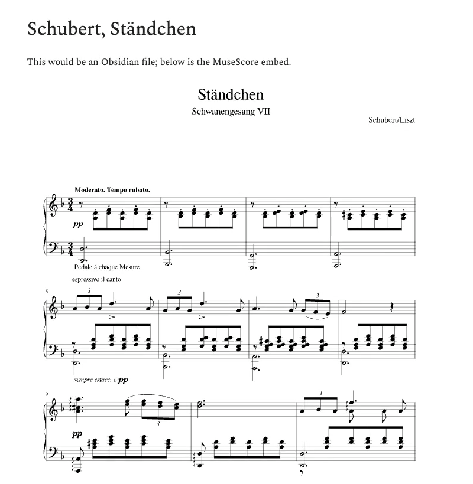
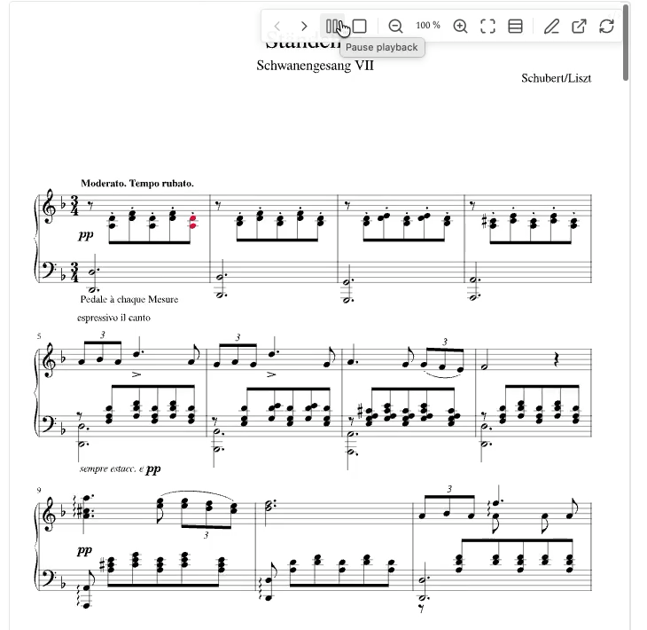
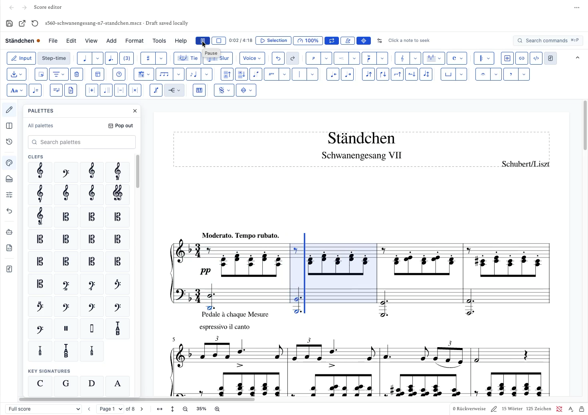

# MuseScorer for Obsidian

Embed native MuseScore `.mscz` and `.mscx` scores in Obsidian, play them with note highlighting, and edit them in a dedicated tab. Rendering, editing and playback work locally, without an account or runtime downloads.

**Desktop · Obsidian 1.7.2+ · Version 0.0.1**

[Install](#install) · [Embed a score](#embed-a-score) · [Playback](#playback-and-controls) · [Editor](#edit-a-score) · [Troubleshooting](#troubleshooting)



*Schubert/Liszt: Ständchen, embedded in an Obsidian note. Controls appear on hover or keyboard focus.*

## Built on OTS_WebEditor

> [!IMPORTANT]
> **MuseScorer is an Obsidian adaptation of [OTS_WebEditor by OurTextScores and its contributors](https://github.com/OurTextScores/OTS_WebEditor).** The complete notation editor, its interaction tools, native engine bridge and original playback/following systems come from that project. This plugin would not exist without their work.

Explore the [original repository](https://github.com/OurTextScores/OTS_WebEditor) and [OurTextScores editor](https://www.ourtextscores.com/score-editor). MuseScorer adds Obsidian note embeds, local editor hosting, vault saving, draft recovery and embed playback controls. The engraving and synthesis engine comes from [MuseScore](https://github.com/musescore/MuseScore); the plugin started from the [official Obsidian sample plugin](https://github.com/obsidianmd/obsidian-sample-plugin).

## Install

MuseScorer is available through [Obsidian Community plugins](https://community.obsidian.md/plugins/musescorer). MuseScore itself does not need to be installed to render, edit or play scores in Obsidian.

### Install through Obsidian — recommended

1. Open **Settings → Community plugins** in Obsidian Desktop.
2. Enable community plugins if prompted.
3. Select **Browse** and search for **MuseScorer**.
4. Select **Install**, then **Enable**.

You can now [embed your first score](#embed-a-score).

### Manual installation — alternative

1. Download **MuseScorer.zip** from the [0.0.1 release](https://github.com/kpaede/Musescorer/releases/tag/0.0.1). Choose this asset, rather than GitHub’s **Source code** archive.
2. Extract the ZIP. Place its **musescorer** folder inside your vault’s `.obsidian/plugins/` folder. Create `plugins/` if it does not exist.
3. Check that the files are directly inside `musescorer/`, as shown below. Avoid an extra nested folder.
4. Restart Obsidian. In **Settings → Community plugins**, enable community plugins if prompted, then enable **MuseScorer**.

```text
Your vault/
└── .obsidian/
    └── plugins/
        └── musescorer/
            ├── main.js
            ├── manifest.json
            └── styles.css
```

`.obsidian` is a hidden folder; show hidden files in your file manager if needed. Alternatively, download the three individual release assets into the same `musescorer/` folder.

> [!NOTE]
> The complete engine, editor, fonts, soundfont and licenses are bundled into the approximately **40 MB** `main.js`. No extra WASM or editor folders are needed. This exceeds **Obsidian Sync Standard’s per-file limit**; install the plugin separately on each desktop device.

### Update an existing installation

For a Community plugins installation, open **Settings → Community plugins**, select **Check for updates**, and install any available MuseScorer update.

For a manual installation, disable **MuseScorer**, replace the three program files with those from the release, and enable it again. Keep the `drafts/` folder if it exists: it contains editor recovery snapshots.

If you installed the preliminary beta with the uppercase ID `MuseScorer`, disable it first, rename its plugin folder to `musescorer`, and replace the three files. The permanent plugin ID is **musescorer**; the displayed name is **MuseScorer**.

## Embed a score

1. Put a MuseScore `.mscz` or `.mscx` file anywhere inside your vault. The examples below assume your score is saved as `Scores/Ständchen.mscz`.
2. Paste this code block into an Obsidian note:

````markdown
```musescore
path: "Scores/Ständchen.mscz"
```
````

3. Switch to **Reading view**, or move the cursor outside the code block in **Live Preview**. The score will render inside the note. The first score may take a moment to load.

Replace the example path with your own file’s path **from the vault root**. For example, a file in `Music/Quartet/Score.mscz` uses exactly that path, regardless of which folder contains the note. Use `/` between folders. Spaces and Unicode filenames work; keep paths in quotes.

For a quick embed, a single path also works:

````markdown
```musescore
Scores/Ständchen.mscz
```
````

### Choose how pages appear

| Mode | Add to the code block | How you read the score |
| --- | --- | --- |
| Scrollable page view — default | Omit `view`, or use `view: page` | Starts on page one. Scroll inside the embed or use its page arrows. |
| All pages | `view: full` | Pages appear vertically with a small gap. Scroll the Obsidian note. |

To embed the entire score:

````markdown
```musescore
path: "Scores/Ständchen.mscz"
view: full
```
````

In `view: full`, a small gap separates pages. Score paper stays white in both light and dark themes.

The toolbar’s **Show all pages** / **Show scrollable page view** button lets you try either layout. To keep the choice when reopening the note, change `view` in the code block.

## Playback and controls

Hover over an embedded score to reveal its toolbar. Hover over an icon to read its label. Keyboard focus inside the score also reveals the controls.



*During playback, Play becomes Pause and the sounding notes are highlighted. Pause holds your place; Resume continues from there.*

| Control | What it does |
| --- | --- |
| **Previous page** / **Next page** | Move between pages in the default scrollable view. |
| **Play score** → **Pause playback** → **Resume playback** | Start, pause and continue at the same position. |
| **Stop playback** | Stop and clear the highlights. The next Play starts at the beginning. |
| **Zoom out** / **Zoom in** / **Fit to width** | Adjust the size of the notation inside the embed. |
| **Show all pages** / **Show scrollable page view** | Switch the current embed’s layout. |
| Pencil · **Open in score editor** | Open this score in an editor tab. |
| External-link arrow · **Open in MuseScore** | Open the source file in the associated desktop application. |
| **Reload score** | Render the source file again. Source file changes also refresh the embed automatically. |

Playback follows the score automatically. In page view, the embed scrolls and turns pages; in full view, the surrounding note scrolls to keep the playing notes visible. Only one score plays at a time across embeds and editors.

The first playback loads the bundled soundfont and may take a moment. Audio uses **FluidR3Mono GM**, not Muse Sounds or MuseSampler. No online audio service is used.

## Edit a score

Select the **pencil** on an embed. The score opens in a new Obsidian tab using the complete original **OTS_WebEditor** interface. Opening the same file again returns to its existing editor tab.

You can also right-click a `.mscz` or `.mscx` file in Obsidian’s file explorer and select **Open in score editor**, or open the command palette and run **MuseScorer: Open score editor**.



*Ständchen during playback in the OTS editor, with a blue playhead and highlighted notes.*

Use the original editor’s **File**, **Edit**, **View**, **Add**, **Format**, **Tools** and **Help** menus, note input, palettes, inspector, undo/redo and playback controls. Select notes on the page to edit them. The editor also provides tempo and selection playback controls.

### Save your work

1. In the toolbar **above** the notation editor, select **Save a new score copy to the vault**. You can also use **Ctrl+S** on Windows/Linux or **⌘S** on macOS.
2. Enter a vault-relative path ending in `.mscz`, such as `Scores/Ständchen (edited).mscz`. Choose an existing folder and a filename that is not already in use.
3. Select **Save copy**.
4. To display that saved version in a note, update the embed’s `path` to the new file.

The original source file is preserved. Editor changes are also kept as local recovery drafts; reopening the score restores its draft with a fresh undo history. To discard the draft, select **Reload original** and confirm **Discard draft**. Saved copies are kept.

### Open the file in MuseScore

Select **Open in MuseScore** on an embed or in the editor’s upper toolbar. This opens the **original source file**, so save a copy first if you want to take your editor changes with you. Open that saved copy from its own embed or editor tab.

This action uses your operating system’s file association. Install MuseScore and associate `.mscz` and `.mscx` files with it if another application opens instead.

## Troubleshooting

| What you see | What to check |
| --- | --- |
| MuseScorer does not appear in the plugin list | Check the folder name `musescorer` and the three files directly inside it. Restart Obsidian and check **Settings → Community plugins**. |
| The note shows the code instead of the score | Use a fenced `musescore` block, enable the plugin, and switch to Reading view or leave the block in Live Preview. |
| **File not found** | Use the exact filename and a path from the vault root, including `.mscz` or `.mscx`. The file must be inside this vault. |
| The embed still shows the old score after editing | Save a new copy, then change the embed’s `path` to that copy. A recovery draft does not replace the source file. |
| Playback takes a moment to start | The first playback loads the local soundfont. Wait for it to finish and check your system volume and audio output. |
| **Could not read the MuseScore file** | Try opening the file in MuseScore, then save a fresh `.mscz` copy. Damaged or unsupported files cannot be rendered. |

### Current limits

- **Desktop only.** Obsidian 1.7.2 or newer is required; mobile is not supported.
- **Large local engine.** The bundle is about 40 MB. The engine starts with a 512 MiB WASM heap and needs more memory for scores, fonts and audio. Large scores or several editor tabs can use substantially more.
- **Local editor features.** Website-only AI, cloud/catalog and server conversion features are unavailable. **Performance mode** is disabled in Obsidian. Normal editing and playback remain available.
- **Layout differences.** The bundled MuseScore Studio 4.7.4 engine recalculates layout. Other MuseScore versions or unavailable custom fonts can produce differences.

## Privacy, licenses and development

Scores are processed locally. The plugin has no telemetry, account requirement or runtime downloads. Recovery snapshots are stored in the plugin’s `drafts/` folder. Rendering, editing and playback do not send scores to a server.

MuseScorer is licensed under [GPL-3.0-only](LICENSE). Use **MuseScorer: Show credits and licenses** in Obsidian’s command palette to read the bundled notices offline. See [third-party notices](THIRD_PARTY_NOTICES.md) for the engine, editor, fonts and soundfont attribution.

- [Development guide](docs/development.md): building, tests, offline bundling and runtime architecture.
- [Upstream maintenance](docs/upstream.md): pinned dependencies, the OTS fork and update checks.
- [Engine integration](docs/engine.md), [validation](docs/validation.md) and [release notes](docs/releases/0.0.1.md).
- [Report a bug](https://github.com/kpaede/Musescorer/issues): include your Obsidian version, operating system and reproduction steps. Share a score only if you are comfortable making it public.
